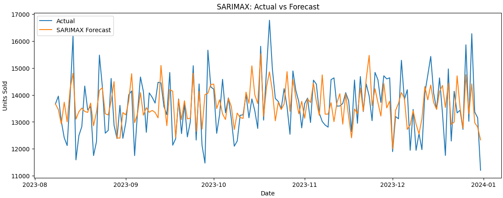

# Retail Sales Time Series Forecasting

A data science project exploring retail sales forecasting using historical sales data and operational variables across 5 stores and 20 products. Multiple forecasting models were developed and evaluated to identify the most effective approach for predicting daily sales and supporting inventory planning.

The analysis compared Naive, ARIMA, SARIMA, Prophet, and SARIMAX models, with SARIMAX achieving the lowest MAE and RMSE on the test dataset.

## Key Results

Five forecasting approaches were evaluated on a chronological test set, with SARIMAX delivering the strongest overall performance.

| Model | MAE | RMSE |
|---|---:|---:|
| Naive Baseline | 1,171.45 | 1,479.49 |
| ARIMA | 845.69 | 1,054.17 |
| SARIMA | 1,152.64 | 1,441.97 |
| Prophet | 875.36 | 1,085.78 |
| **SARIMAX** | **648.14** | **826.16** |

- Reduced MAE by **44.7%** compared with the naive baseline.
- Reduced RMSE by **44.2%** compared with the naive baseline.
- Inventory Level was the strongest statistically significant predictor in the fitted SARIMAX model (*p* < 0.001).

### Actual vs Forecast

The model closely captures fluctuations in retail demand by incorporating external factors.  

## Key Findings

- **Inventory:** Strongest statistically significant predictor of sales (*p* < 0.001).
- **Discounts:** Virtually no measurable relationship with sales.
- **Seasonality:** Weak temporal patterns limited the effectiveness of univariate forecasting models.

## Business Recommendations

- **Increase Stock Availability:** Raise minimum inventory thresholds where commercially viable to reduce stock constraints and support potential sales growth.
- **Reduce Routine Discounts:** Scale back routine and seasonal discounting where no measurable sales benefit is evident. Reassess if future sales patterns change.
- **Integrate Forecasting with Inventory Planning:** Use SARIMAX forecasts alongside inventory and replenishment planning, incorporating operational variables to improve demand estimates.

## Limitations

- **Limited Historical Data:** The dataset covers approximately two years, potentially limiting the capture of longer-term demand patterns.
- **Weak Temporal Patterns:** Historical sales showed limited autocorrelation and weak seasonality, restricting the effectiveness of univariate forecasting models.
- **Future Input Requirements:** SARIMAX requires future values of operational variables, such as inventory, pricing and promotions, to generate forecasts.
